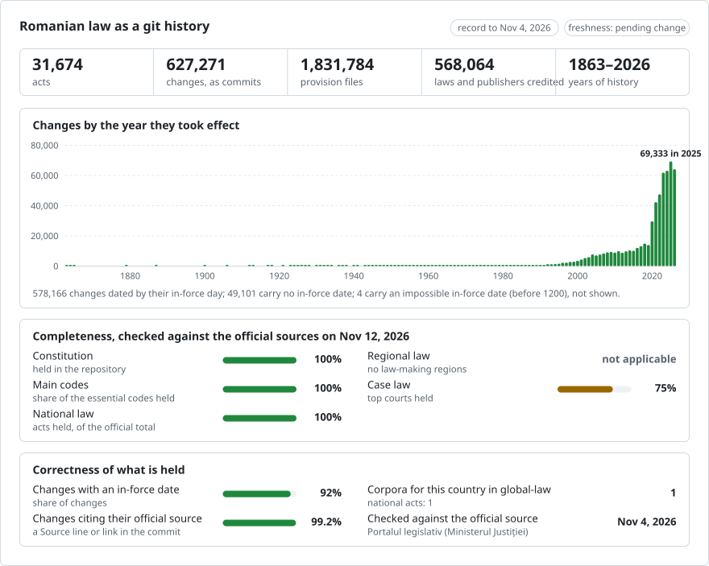

# Romania: law history in git

**English** · **[Sau citiți în română](README.md)**

<picture>
<source media="(prefers-color-scheme: dark)" srcset="data/effort-dark.svg">

</picture>

The law of Romania as a git history: one file per article, one commit per version on the day it took effect, and the act that made each change as the commit's author. `git blame` names the act behind every paragraph; `git log` lists every change to an article; picking a date gives the text in force that day.

Part of [lexifina/global-law](https://github.com/lexifina/global-law), one git history for every country's law: this is Romania's national law, which global-law reads at `romania/national/acts/`.

**What is in it now:** the Constitution and 23,210 laws, ordinances, decrees and decisions of Parliament, the codes among them, with 34,813 versions; 41,983 Government decisions; 40,746 ministerial orders, 8,968 norms, regulations and other acts of authorities such as the BNR, ASF and ANCOM, and 3,797 annexes published on their own; 2,536 acts of the legal professions' bodies; 375,166 local council decisions from 1,341 councils; 16,409 EU acts in Romanian and 2,579 treaties; 28,231 court decisions (23,509 of the Constitutional Court, 2,019 of the High Court of Cassation and Justice, 1,605 ECHR judgments against Romania, 568 EU Court of Justice decisions concerning Romania and 530 of other courts); 6,589 drafts and bills, labelled as not law; and 16,862 decisions and other documents of public bodies (CNSC, CNCD, the Ombudsman, the electoral bodies, ANSPDCP, the Court of Accounts). [`PLAN.md`](PLAN.md) lists every part this repository is meant to hold and how far each one is; [`ACTS.md`](ACTS.md) lists the primary legislation, and [`DATA.md`](DATA.md) every other list and table.

Each act is in a folder named by its official identifier, `<kind>/<year>/<number>/`, one file per article (`lege/2009/286/` is the Codul penal, Legea nr. 286/2009; `lege/2003/53/` is the Codul muncii, the Labour Code); the Constitution is [`constitutie/1991/`](constitutie/1991/). Court decisions are in `jurisprudenta/`, local acts in `local/` by council and year, drafts and bills in `proiect/`. `data/paths.json` maps each act id to its folder; commits made before the layout move of November 2026 use the id (`codul-penal/`).

The text is in Romanian, as its official sources publish it. An English translation is not part of this record.

## Questions as git commands

| Question | Command |
| --- | --- |
| Every change to Article 336 of the Codul penal | `git log --follow -p --word-diff -- lege/2009/286/art-336.md` |
| Which act wrote each paragraph of Article 336? | `git blame lege/2009/286/art-336.md` |
| Every version of the Codul penal, with the day each took effect | `git log --format="%h %(trailers:key=In-force,valueonly,separator=) %an" -- lege/2009/286 codul-penal` |
| Article 336 as in force on 1 January 2020 | `python tools/on.py 2020-01-01 lege/2009/286 336` |

**Outside git**, we also host this record publicly, for free:

- **[Ask Claude about Romanian law](https://global-law.lexifina.com/v1/try_claude?country=romania)**: opens Claude with a first question ready.
- **[Ask ChatGPT](https://global-law.lexifina.com/v1/try_chatgpt?country=romania)**: the same question in ChatGPT.
- **[Call the API in your browser](https://global-law.lexifina.com/v1/search_law?query=concediu+de+odihn%C4%83&jurisdictions=romania)**: a search of Romanian law for "concediu de odihnă", returned as JSON. See the [documentation here](https://lexifina.com/api/global-law).

Both assistants read the record through the free Global law connector (MCP, `https://global-law.lexifina.com/mcp`); the first time, the chat gives you the link that adds it. Ask in Romanian, with or without diacritics, or in English.

**Host it yourself easily.** All it takes is git and Python, and the tools run on your machine:

```sh
git clone --depth 1 https://github.com/lexifina/global-law && cd global-law
python3 tools/countries.py add romania/national/acts
python3 tools/law.py show 2026-01-01 romania/national/acts/lege/2009/286/art-336.md
```

Opened in Claude Code, Cursor, VS Code or Codex, the clone also starts a local MCP server with the same tools ([MCP.md](https://github.com/lexifina/global-law/blob/main/MCP.md)).

## Dates

Each commit is dated at noon, Europe/Bucharest, on the day the version took effect, and carries it in its `In-force:` trailer; the days the act was enacted and published are the `Enacted:` and `Published:` trailers:

- the day the Portalul legislativ gives, in its note on the amended provision ("la DD-MM-YYYY") or as the date of the consolidated form; the Constitution's default (art. 78: three days after publication in the Monitorul Oficial) is not applied in its place;
- a Constitutional Court finding that strikes whole articles, paragraphs or letters of a law or ordinance in force takes effect 45 days after its publication (Constituția art. 147(1)), unless the provision was brought into line by then; findings not applied to the text are listed in `data/court-notes.csv`;
- git cannot store dates before 1970, so the 823 commits in force earlier are dated 1 January 1970, with the real day in `In-force:`. Ask for a date with `tools/on.py`, not `git log --before`.

Each change is credited to the act that made it, as the portal's amendment notes name it (`Legea nr. 172/2024`); a change no note explains to `Portalul legislativ (Ministerul Justiției)` (3,712 commits), a text struck by the Constitutional Court to its decision (`Decizia CCR nr. 732/2014`, 117 commits), a court decision to its court, and a draft or bill to its initiator, dated on the day each stage was published and with no `In-force:` trailer. Wrong versions are corrected by commits of their own, which restate the versions after them too, credited to Lexifina (`Kind: correction`, 2,722); no published commit is rewritten.

## How current it is

`python tools/freshness.py <act>` gives an act's status, its last check against the official source and its official link; [data/status.json](data/status.json), refreshed every hour, says whether updates are running and which official sources are answering ([DATA.md](DATA.md#freshness)).

## How it is checked

- `tools/build/check_repo.py` reads every version back from git on the day it took effect, and on the day before, choosing commits by `In-force:` as `tools/on.py` does, and compares it with the corpus file by file; the result of each build goes into [`REPRODUCE.md`](REPRODUCE.md), with the corpus and builder hashes (the same corpus always gives the same commit hashes).
- Every commit's trailers parse, every law commit has an `In-force:` trailer and no draft has one; `main` has no merge commits, its commit dates never go backwards and none is in the future.
- Every version names the official page it was read from (`Source:`, `Consolidated:`), and acts are checked again against their official source for later changes ([data/freshness.json](data/freshness.json)).

## What it does not show

- **Every version of every act.** 7,837 acts of the primary legislation are amended but not consolidated: they hold the act as published, with the amending acts named in their README; 7,390 more are as published, their amendments not yet checked.
- **Most court judgments.** 530 of about 26 million judgments of the ordinary courts are here; the High Court's 2,019 are mostly its rulings on points of law (RIL, HP), not its other judgments (see `PLAN.md`).
- **Every council's acts.** 1,341 of the 3,229 local councils `PLAN.md` counts; no prefects' orders or collective labour agreements yet.
- **Headings and facsimiles.** Chapter and section headings, the portal's editorial notes and annexes printed as facsimiles are not in the files.
- **The act behind restated lines.** Where correction commits restated an act's versions (the Codul muncii, Legea nr. 95/2006 and others), `git blame` names the correction; `git log --follow` still lists the act behind each change.
- **Personal data.** CNPs, home addresses and dates of birth are removed; decisions in criminal matters, and other decisions that name private persons, are often metadata only. Anyone named can ask for a correction or removal via [lexifina.com](https://lexifina.com).

## Sources

| Source | Kind | Past versions | Notes |
| --- | --- | --- | --- |
| [Portalul legislativ](https://legislatie.just.ro) (Ministerul Justiției) | Official legislation service | yes, every consolidated form it publishes | The texts, their versions and the amendment notes, also from archived copies of its pages; only the Monitorul Oficial, Part I is authoritative |
| Each council's Monitorul Oficial Local | Local acts | as published | Decisions of the councils, by council and year |
| [EU Publications Office](https://op.europa.eu) (CELLAR) | EU law in Romanian, EU Court of Justice | as published | Acts in force and the operative part of decisions concerning Romania; the Official Journal of the EU is authoritative |
| [Camera Deputaților](https://www.cdep.ro), [Senatul](https://www.senat.ro), the ministries | Bills, drafts, links between acts | as published | Labelled as not law |
| The authorities' own sites (BNR, ASF, ANRE, ANCOM, CNSC, CNCD and others), [HUDOC-EXEC](https://hudoc.exec.coe.int) | Regulators' acts, other bodies' decisions, ECHR judgments | as published | Each as its publisher issues it |

## Licence

See [`LICENSE`](LICENSE). The legal texts are official texts of Romanian normative acts (Sursa: Portalul legislativ al Ministerului Justiției, https://legislatie.just.ro), excluded from copyright by Legea nr. 8/1996, art. 9 lit. b; the EU texts are © European Union, reused under Commission Decision 2011/833/EU. Lexifina's arrangement of the history, commit messages, tables and tools are dedicated to the public domain (CC0 1.0). No AI model wrote, translated or corrected legal text, and none runs when the history is built; the scripts were written by an AI model (see [`REPRODUCE.md`](REPRODUCE.md)).

## Built from it

- [visualisations/](visualisations/): Romanian law in 30 charts: who makes it (Parliament's laws or the Government's emergency ordinances), the codes, the Constitutional Court, the Fiscal Code, the Official Gazette, and Romania against its neighbours, Spain and the rest of global law.
- [Textdelege](https://textdelege.ro), by [@bogdantoma27](https://github.com/bogdantoma27) and independent of Lexifina: the Constitution and 20 codes, read from this repository every day, with every version of each article, the act behind each paragraph and the CCR and ÎCCJ decisions on it.

## More

From [lexifina/global-law](https://github.com/lexifina/global-law):

- [FEATURES.md](https://github.com/lexifina/global-law/blob/main/FEATURES.md): every feature, and what every corpus must support (`git blame`, `law.py`, the MCP tools)
- [FAQ.md](https://github.com/lexifina/global-law/blob/main/FAQ.md): questions and answers · [CONTRIBUTING.md](https://github.com/lexifina/global-law/blob/main/CONTRIBUTING.md): proposing changes · [MCP.md](https://github.com/lexifina/global-law/blob/main/MCP.md): the MCP server · [REPRODUCE.md](https://github.com/lexifina/global-law/blob/main/REPRODUCE.md): how it was built · [CHANGELOG.md](https://github.com/lexifina/global-law/blob/main/CHANGELOG.md)
- [FRESHNESS.md](https://github.com/lexifina/global-law/blob/main/FRESHNESS.md): how current each corpus is · [Monitoring](https://github.com/lexifina/global-law/tree/main/monitoring): whether updates are running · [WATCHING.md](https://github.com/lexifina/global-law/blob/main/WATCHING.md): how each official source is watched for changes
- [performance/](https://github.com/lexifina/global-law/tree/main/performance): how fast the tools are, measured
- [visualisations/](https://github.com/lexifina/global-law/tree/main/visualisations): charts and bridges across the world's law
- [Vulnerabilities](https://github.com/lexifina/global-law/tree/main/vulnerabilities): mistakes in legislation as published
