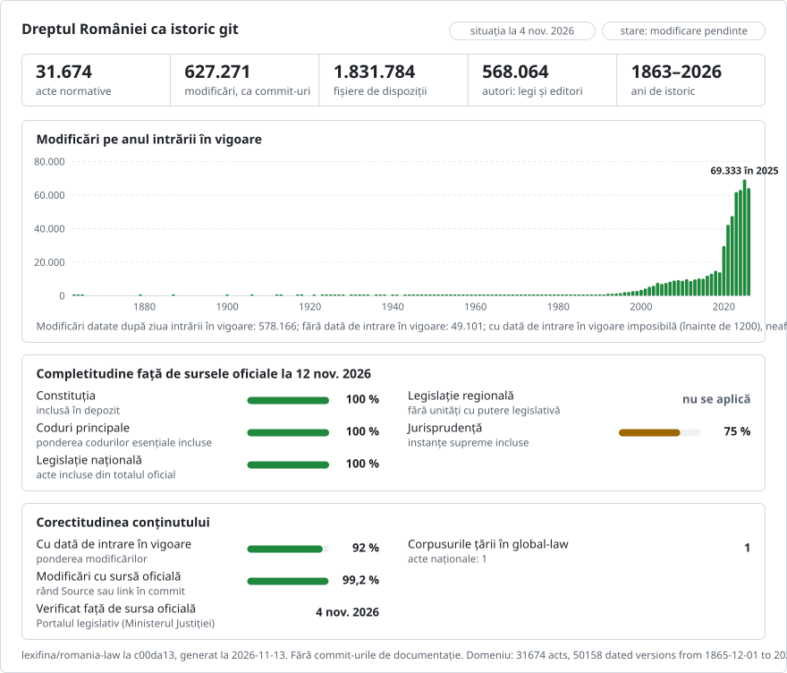

# România: istoria dreptului în git

**Română** · [English](README.en.md)

Face parte din [lexifina/global-law](https://github.com/lexifina/global-law), o singură istorie git pentru dreptul tuturor țărilor: acesta este dreptul național al României, pe care global-law îl citește la `romania/national/acts/`.

Scopul: toate sursele de care are nevoie un jurist sau un cetățean român, într-o singură istorie git. Legile cu întreaga lor istorie, jurisprudența, legislația secundară, actele locale și altele: [planul](PLAN.md) enumeră fiecare parte, cu stadiul ei.

**Conținut**
- Dreptul românesc reconstituit din textele oficiale ca o singură istorie git: Constituția, codurile și zeci de mii de legi, ordonanțe și hotărâri ale Guvernului, împreună cu legislația secundară, actele locale, tratatele și dreptul Uniunii Europene.
- Deciziile Curții Constituționale și ale Înaltei Curți de Casație și Justiție, legate de articolele la care se referă, împreună cu hotărârile CEDO pronunțate împotriva României și deciziile Curții de Justiție a Uniunii Europene privitoare la România.

**Utilizare**
- Portalul oficial arată o singură versiune a unui act la un moment dat. Aici, felul în care s-a modificat o dispoziție sau ce prevedea ea la o anumită dată se află cu un singur `git log` sau `git blame`.
- Totul poate fi căutat, comparat și reutilizat: textele sunt oficiale, iar munca noastră este în domeniul public (CC0).

<picture>
<source media="(prefers-color-scheme: dark)" srcset="data/ro/effort-dark.svg">

</picture>

### Exemplu de utilizare: serverul MCP pentru România

https://github.com/user-attachments/assets/3f47ad88-f514-4765-97e3-ff67ed8f79b4

Un asistent AI răspunde la o întrebare despre dreptul românesc prin serverul MCP: răspunsul citează articolul și versiunea exacte din acest depozit, cu linkurile oficiale.

### Dreptul românesc, în grafice

Unul dintre cele treizeci de grafice realizate pe baza acestui depozit; celelalte se află în [visualisations/](visualisations/).

## Structură

| Unde | Ce conține |
| --- | --- |
| `constitutie/1991/`, `lege/`, `oug/`, `og/`, `hg/` | Constituția, legile (inclusiv codurile: Codul civil este `lege/2009/287/`), ordonanțele și hotărârile Guvernului, pe an și număr |
| `ordin/`, `norma/`, `regulament/`… | ordinele miniștrilor și normele autorităților |
| `local/` | hotărârile consiliilor locale, pe consiliu și an |
| `ue/`, `tratat/`, `anexa/`, `profesii/` | dreptul Uniunii Europene în limba română, tratatele, anexele oficiale, regulile profesiilor juridice |
| `jurisprudenta/` | hotărârile instanțelor: `ccr/`, `iccj/`, `cedo/`, `cjue/` |
| `proiect/` | proiecte și propuneri legislative, **nu sunt lege**: proiecte de acte supuse consultării publice și propuneri legislative aflate în Parlament, pe inițiator și an |
| `<act>/art-NNN.md` · `<act>/README.md` | un articol pe fișier (un alineat pe rând) · versiunile și notele actului |
| [ACTS.md](ACTS.md) · `data/` · `tools/` | lista actelor · tabele și indexuri ([DATA.md](DATA.md)) · instrumentele de mai jos |

[AGENTS.md](AGENTS.md) explică modul în care un program sau un agent AI trebuie să interogheze depozitul.

## Cum se folosește

| Întrebare | Comandă |
| --- | --- |
| Ce prevedea art. 1112 din Codul civil la 18 octombrie 2014? | `python tools/on.py 2014-10-18 lege/2009/287 1112` |
| Ce act a redactat fiecare alineat al art. 336 din Codul penal? | `git blame lege/2009/286/art-336.md` |
| Fiecare modificare a unui articol, cuvânt cu cuvânt | `git log --follow -p --word-diff lege/2009/286/art-297.md` |
| Tot ce a modificat un act | `git show law/legea-200-2023` |
| Este la zi Codul civil de aici? | `python tools/freshness.py codul-civil` |

Citiți datele cu instrumentele, nu cu `git rev-list --before`: acestea aleg fiecare versiune după trailerul ei `In-force:`.

## Date, jurisprudență și surse

- **Tabele:** liste și indexuri ale actelor, legăturile dintre acte, proiectele din spatele fiecărei legi, transpunerea dreptului Uniunii Europene și tabele practice (instanța competentă pentru fiecare localitate, taxele judiciare de timbru, termenele, ajutorul public judiciar, salariul minim, dobânda legală). Toate sunt enumerate în [DATA.md](DATA.md).
- **Jurisprudență:** deciziile Curții Constituționale și ale Înaltei Curți de Casație și Justiție (RIL și HP) așa cum au fost publicate în Monitorul Oficial, hotărârile CEDO pronunțate împotriva României și deciziile Curții de Justiție a Uniunii Europene privitoare la România (dispozitivul). Fiecare decizie este un commit; o decizie a Curții Constituționale care a constatat neconstituționalitatea unui text este un commit separat în istoria actului respectiv.
- **Surse:** portalul legislativ al Ministerului Justiției, copiile arhivate ale acestuia, Parlamentul, Oficiul pentru Publicații al Uniunii Europene și autoritățile emitente ([DATA.md](DATA.md#sources)).

## Cât de actualizat este

Fiecare versiune indică pagina oficială din care a fost citită, astfel încât fiecare act poate fi verificat față de sursa sa.

<!-- freshness-summary -->
Verificat față de sursele oficiale: 2026-11-08; 89% dintre acte verificate în ultimele 7 zile, 89% în ultimele 30 ([data/freshness.json](data/freshness.json)).
<!-- /freshness-summary -->

`python tools/freshness.py <act>` indică starea unui act, ultima sa verificare și linkul oficial. Fluxul de actualizare este monitorizat permanent, iar [data/status.json](data/status.json) (actualizat din oră în oră) arată dacă actualizările funcționează și care surse oficiale răspund. Stările și câmpurile: [DATA.md](DATA.md#freshness).

## Datare, autori și limite

- Fiecare commit poartă data zilei în care modificarea a intrat în vigoare; autorul este actul care a făcut-o, iar committerul este Lexifina.
- Proiectele și propunerile legislative din `proiect/` nu sunt lege și nu au fost niciodată în vigoare, decât dacă și din momentul în care sunt adoptate. Commiturile lor sunt marcate `Kind: draft`, nu au trailerul `In-force:` și poartă data zilei în care a fost publicată fiecare etapă; autorul este inițiatorul (un minister, Guvernul sau parlamentarii, în ansamblu). `tools/on.py` nu le returnează niciodată, iar README-ul fiecărui proiect trimite la actul în care a devenit.
- Cea mai recentă versiune a unui act este cea mai nouă formă consolidată deținută, deci este posibil să lipsească modificări ulterioare; actele marcate `amended, not consolidated` (modificat, neconsolidat) conțin actul așa cum a fost publicat și indică actele de modificare.
- Numai Monitorul Oficial, Partea I, este autentic (pentru actele Uniunii Europene, Jurnalul Oficial al Uniunii Europene).
- Nu sunt incluse: titlurile capitolelor și secțiunilor, notele editoriale ale portalului și anexele tipărite în facsimil.
- Fiecare versiune este recitită din git în ziua intrării ei în vigoare și trebuie să coincidă cu sursa; rezultatele sunt în `REPRODUCE.md`.

## Ecosistem

Proiecte construite de alte persoane pe baza acestui depozit. Ele sunt independente de Lexifina; erorile din textele juridice se semnalează tot aici.

- **[Textdelege](https://textdelege.ro)**: o interfață de lectură pentru Constituția și 20 de coduri. Pentru fiecare articol arată fiecare versiune cu perioada în care s-a aplicat, actul din spatele fiecărui alineat, comparații cuvânt cu cuvânt între versiuni, legea așa cum era la orice dată, precum și deciziile CCR și ÎCCJ privitoare la articol. Este actualizată zilnic din acest depozit, iar fiecare pagină trimite la fișierul și commitul din care a fost generată. Autor: [@bogdantoma27](https://github.com/bogdantoma27).

Ați construit ceva pe baza acestor date? Deschideți un issue și proiectul poate fi inclus aici.

## Date cu caracter personal

Actele oficiale sunt republicate așa cum le-a tipărit Monitorul Oficial, inclusiv cu numele persoanelor la care se referă. CNP-urile, adresele de domiciliu și datele nașterii sunt eliminate, iar din hotărârile în materie penală sunt păstrate doar metadatele. Orice persoană menționată poate cere o rectificare sau o eliminare prin [lexifina.com](https://lexifina.com).

## Licență

Textele juridice sunt texte oficiale ale actelor normative românești (Sursa: Portalul legislativ al Ministerului Justiției, https://legislatie.just.ro), care nu beneficiază de protecția dreptului de autor potrivit Legii nr. 8/1996, art. 9 lit. b. Textele Uniunii Europene sunt © Uniunea Europeană, reutilizate în temeiul Deciziei 2011/833/UE a Comisiei. Organizarea, tabelele, mesajele de commit și instrumentele realizate de Lexifina sunt în domeniul public (CC0), conform `LICENSE`. Acest depozit nu constituie consultanță juridică și nu este o publicație oficială.

Aceasta este o traducere a versiunii în engleză ([README.en.md](README.en.md)); dacă diferă, prevalează versiunea în engleză.

## Mai multe

Din depozitul [lexifina/global-law](https://github.com/lexifina/global-law) (pagini în engleză):

- [FEATURES.md](https://github.com/lexifina/global-law/blob/main/FEATURES.md): toate funcțiile și ce trebuie să suporte fiecare corpus (`git blame`, `law.py`, instrumente MCP)
- [FAQ.md](https://github.com/lexifina/global-law/blob/main/FAQ.md): întrebări și răspunsuri · [CONTRIBUTING.md](https://github.com/lexifina/global-law/blob/main/CONTRIBUTING.md): propunerea de modificări · [MCP.md](https://github.com/lexifina/global-law/blob/main/MCP.md): serverul MCP · [REPRODUCE.md](https://github.com/lexifina/global-law/blob/main/REPRODUCE.md): cum a fost construit · [CHANGELOG.md](https://github.com/lexifina/global-law/blob/main/CHANGELOG.md)
- [FRESHNESS.md](https://github.com/lexifina/global-law/blob/main/FRESHNESS.md): cât de actualizat este fiecare corpus · [Monitorizare](https://github.com/lexifina/global-law/tree/main/monitoring): dacă actualizările funcționează · [WATCHING.md](https://github.com/lexifina/global-law/blob/main/WATCHING.md): cum este urmărită fiecare sursă oficială pentru modificări
- [performance/](https://github.com/lexifina/global-law/tree/main/performance): cât de rapide sunt instrumentele, măsurat
- [visualisations/](https://github.com/lexifina/global-law/tree/main/visualisations): grafice și legături în dreptul întregii lumi
- [Vulnerabilități](https://github.com/lexifina/global-law/tree/main/vulnerabilities): erori în actele normative așa cum au fost publicate
