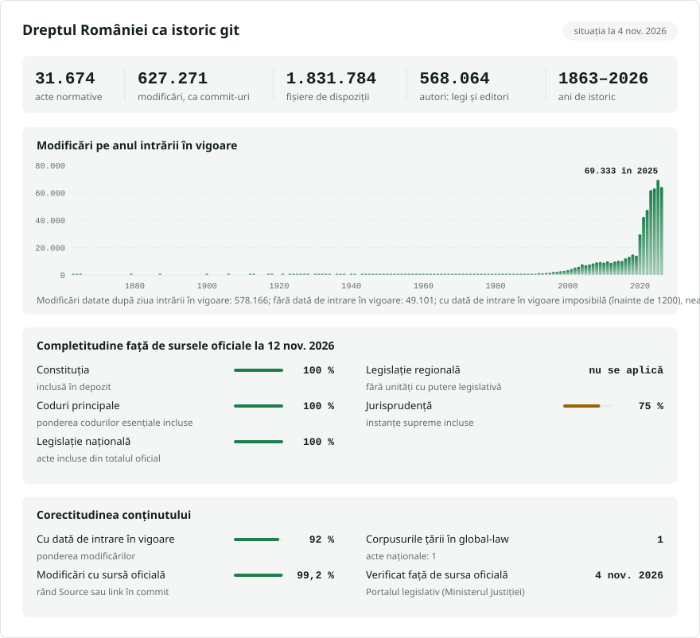

# România: istoria dreptului în git

**Română** · **[Or read it in English](README.en.md)**

<picture>
<source media="(prefers-color-scheme: dark)" srcset="data/ro/effort-dark.svg">

</picture>

Dreptul României ca istorie git: un fișier pentru fiecare articol, un commit pentru fiecare versiune, în ziua în care a intrat în vigoare, iar autorul fiecărui commit este actul care a făcut modificarea. `git blame` arată actul din spatele fiecărui alineat; `git log` enumeră fiecare modificare a unui articol; alegerea unei date dă textul în vigoare în acea zi.

Face parte din [lexifina/global-law](https://github.com/lexifina/global-law), o singură istorie git pentru dreptul tuturor țărilor: acesta este dreptul național al României, pe care global-law îl citește la `romania/national/acts/`.

**Ce conține acum:** Constituția și 23.210 legi, ordonanțe, decrete și hotărâri ale Parlamentului, printre care și codurile, cu 34.813 versiuni; 41.983 de hotărâri ale Guvernului; 40.746 de ordine ale miniștrilor, 8.968 de norme, regulamente și alte acte ale autorităților precum BNR, ASF și ANCOM, și 3.797 de anexe publicate separat; 2.536 de acte ale organismelor profesiilor juridice; 375.166 de hotărâri ale consiliilor locale, de la 1.341 de consilii; 16.409 acte ale Uniunii Europene în limba română și 2.579 de tratate; 28.231 de hotărâri judecătorești (23.509 ale Curții Constituționale, 2.019 ale Înaltei Curți de Casație și Justiție, 1.605 hotărâri CEDO pronunțate împotriva României, 568 de decizii ale Curții de Justiție a Uniunii Europene privitoare la România și 530 ale altor instanțe); 6.589 de proiecte și propuneri legislative, marcate ca texte care nu sunt lege; și 16.862 de decizii și alte documente ale unor autorități publice (CNSC, CNCD, Avocatul Poporului, autoritățile electorale, ANSPDCP, Curtea de Conturi). [`PLAN.md`](PLAN.md) enumeră toate părțile pe care trebuie să le cuprindă acest depozit și stadiul fiecăreia; [`ACTS.md`](ACTS.md) enumeră legislația primară, iar [`DATA.md`](DATA.md) toate celelalte liste și tabele.

Fiecare act se află într-un dosar numit după identificatorul său oficial, `<tip>/<an>/<număr>/`, cu un fișier pentru fiecare articol (`lege/2009/286/` este Codul penal, Legea nr. 286/2009; `lege/2003/53/` este Codul muncii); Constituția este [`constitutie/1991/`](constitutie/1991/). Hotărârile judecătorești sunt în `jurisprudenta/`, actele locale în `local/`, pe consiliu și an, proiectele și propunerile legislative în `proiect/`. `data/paths.json` leagă identificatorul fiecărui act de dosarul său; commiturile făcute înainte de reorganizarea dosarelor din noiembrie 2026 folosesc identificatorul (`codul-penal/`).

Textul este în limba română, așa cum îl publică sursele oficiale. O traducere în engleză nu face parte din această evidență.

## Întrebări ca comenzi git

| Întrebare | Comandă |
| --- | --- |
| Fiecare modificare a art. 336 din Codul penal | `git log --follow -p --word-diff -- lege/2009/286/art-336.md` |
| Ce act a scris fiecare alineat al art. 336? | `git blame lege/2009/286/art-336.md` |
| Fiecare versiune a Codului penal, cu ziua în care a intrat în vigoare | `git log --format="%h %(trailers:key=In-force,valueonly,separator=) %an" -- lege/2009/286 codul-penal` |
| Art. 336 în forma în vigoare la 1 ianuarie 2020 | `python tools/on.py 2020-01-01 lege/2009/286 336` |

**În afara git**, oferim această evidență și public, gratuit:

- **[Întrebați Claude despre dreptul românesc](https://global-law.lexifina.com/v1/try_claude?country=romania)**: deschide Claude cu o primă întrebare pregătită.
- **[Întrebați ChatGPT](https://global-law.lexifina.com/v1/try_chatgpt?country=romania)**: aceeași întrebare în ChatGPT.
- **[Apelați API-ul în browser](https://global-law.lexifina.com/v1/search_law?query=concediu+de+odihn%C4%83&jurisdictions=romania)**: o căutare în dreptul românesc după „concediu de odihnă”, cu răspunsul în JSON. Documentația este [aici](https://lexifina.com/api/global-law).

Ambii asistenți citesc evidența prin conectorul gratuit Global law (MCP, `https://global-law.lexifina.com/mcp`); prima dată, conversația vă oferă linkul care îl adaugă. Întrebați în română, cu sau fără diacritice, sau în engleză.

**Ușor de rulat chiar de dumneavoastră.** Sunt de ajuns git și Python, iar instrumentele rulează pe calculatorul dumneavoastră:

```sh
git clone --depth 1 https://github.com/lexifina/global-law && cd global-law
python3 tools/countries.py add romania/national/acts
python3 tools/law.py show 2026-01-01 romania/national/acts/lege/2009/286/art-336.md
```

Deschisă în Claude Code, Cursor, VS Code sau Codex, clona pornește și un server MCP local cu aceleași instrumente ([MCP.md](https://github.com/lexifina/global-law/blob/main/MCP.md)).

## Datare

Fiecare commit este datat la prânz, ora Bucureștiului (Europe/Bucharest), în ziua în care versiunea a intrat în vigoare, și poartă această zi în trailerul `In-force:`; zilele adoptării și publicării actului sunt trailerele `Enacted:` și `Published:`:

- ziua indicată de Portalul legislativ, în nota sa la dispoziția modificată („la ZZ-LL-AAAA”) sau ca dată a formei consolidate; regula implicită din Constituție (art. 78: la trei zile de la publicarea în Monitorul Oficial) nu se aplică în locul ei;
- o decizie a Curții Constituționale care constată neconstituționalitatea unor articole, alineate sau litere întregi dintr-o lege sau ordonanță în vigoare produce efecte la 45 de zile de la publicare (Constituția, art. 147 alin. (1)), dacă dispoziția nu a fost pusă de acord până atunci; deciziile neaplicate textului sunt enumerate în `data/court-notes.csv`;
- git nu poate stoca date anterioare anului 1970, așa că cele 823 de commituri în vigoare mai devreme sunt datate 1 ianuarie 1970, cu ziua reală în `In-force:`. Întrebați despre o dată cu `tools/on.py`, nu cu `git log --before`.

Fiecare modificare este atribuită actului care a făcut-o, așa cum îl numesc notele de modificare ale portalului (`Legea nr. 172/2024`). O modificare pe care nicio notă nu o explică este atribuită `Portalul legislativ (Ministerul Justiției)` (3.712 commituri); un text constatat neconstituțional, deciziei Curții Constituționale (`Decizia CCR nr. 732/2014`, 117 commituri); o hotărâre judecătorească, instanței care a pronunțat-o; iar un proiect sau o propunere legislativă, inițiatorului, cu data publicării fiecărei etape și fără trailerul `In-force:`. Versiunile greșite sunt corectate prin commituri proprii, care reiau și versiunile ulterioare, atribuite Lexifina (`Kind: correction`, 2.722); niciun commit publicat nu este rescris.

## Cât de actualizat este

`python tools/freshness.py <act>` arată starea unui act, ultima sa verificare față de sursa oficială și linkul oficial; [data/status.json](data/status.json), actualizat din oră în oră, arată dacă actualizările funcționează și care surse oficiale răspund ([DATA.md](DATA.md#freshness)).

## Cum se verifică

- `tools/build/check_repo.py` recitește din git fiecare versiune în ziua în care a intrat în vigoare și în ziua precedentă, alegând commiturile după `In-force:`, ca `tools/on.py`, și o compară fișier cu fișier cu corpusul; rezultatul fiecărei generări a depozitului intră în [`REPRODUCE.md`](REPRODUCE.md), împreună cu hashurile corpusului și ale scripturilor de generare (același corpus dă întotdeauna aceleași hashuri de commit).
- Trailerele fiecărui commit sunt valide, fiecare commit de lege are trailerul `In-force:`, iar niciun proiect nu îl are; `main` nu are commituri de tip merge, datele commiturilor nu merg niciodată înapoi și niciuna nu este în viitor.
- Fiecare versiune indică pagina oficială din care a fost citită (`Source:`, `Consolidated:`), iar actele sunt verificate din nou față de sursa lor oficială pentru modificări ulterioare ([data/freshness.json](data/freshness.json)).

## Ce nu arată

- **Fiecare versiune a fiecărui act.** 7.837 de acte ale legislației primare sunt modificate, dar neconsolidate: conțin actul așa cum a fost publicat, cu actele de modificare indicate în README-ul lor; alte 7.390 sunt așa cum au fost publicate, cu modificările încă neverificate.
- **Majoritatea hotărârilor judecătorești.** Aici sunt 530 din aproximativ 26 de milioane de hotărâri ale instanțelor de drept comun; cele 2.019 ale Înaltei Curți sunt în cea mai mare parte decizii date în recursuri în interesul legii (RIL) și pentru dezlegarea unor chestiuni de drept (HP), nu celelalte hotărâri ale sale (vezi `PLAN.md`).
- **Actele tuturor consiliilor.** 1.341 din cele 3.229 de consilii locale numărate în `PLAN.md`; încă niciun ordin al prefecților și niciun contract colectiv de muncă.
- **Titluri și facsimile.** Titlurile capitolelor și secțiunilor, notele editoriale ale portalului și anexele tipărite în facsimil nu se află în fișiere.
- **Actul din spatele rândurilor reluate.** Acolo unde commituri de corecție au reluat versiunile unui act (Codul muncii, Legea nr. 95/2006 și altele), `git blame` indică corecția; `git log --follow` arată în continuare actul din spatele fiecărei modificări.
- **Date cu caracter personal.** CNP-urile, adresele de domiciliu și datele nașterii sunt eliminate; din hotărârile în materie penală și din alte decizii care numesc persoane private sunt păstrate adesea doar metadatele. Orice persoană menționată poate cere o rectificare sau o eliminare prin [lexifina.com](https://lexifina.com).

## Surse

| Sursă | Tip | Versiuni anterioare | Note |
| --- | --- | --- | --- |
| [Portalul legislativ](https://legislatie.just.ro) (Ministerul Justiției) | Serviciul oficial de legislație | da, fiecare formă consolidată pe care o publică | Textele, versiunile lor și notele de modificare, citite și din copii arhivate ale paginilor sale; numai Monitorul Oficial, Partea I, este autentic |
| Monitorul Oficial Local al fiecărui consiliu | Acte locale | așa cum sunt publicate | Hotărârile consiliilor, pe consiliu și an |
| [Oficiul pentru Publicații al Uniunii Europene](https://op.europa.eu) (CELLAR) | Dreptul Uniunii Europene în limba română, Curtea de Justiție a Uniunii Europene | așa cum sunt publicate | Actele în vigoare și dispozitivul deciziilor privitoare la România; Jurnalul Oficial al Uniunii Europene este autentic |
| [Camera Deputaților](https://www.cdep.ro), [Senatul](https://www.senat.ro), ministerele | Propuneri legislative, proiecte, legăturile dintre acte | așa cum sunt publicate | Marcate ca texte care nu sunt lege |
| Site-urile autorităților (BNR, ASF, ANRE, ANCOM, CNSC, CNCD și altele), [HUDOC-EXEC](https://hudoc.exec.coe.int) | Actele autorităților de reglementare, deciziile altor organisme, hotărârile CEDO | așa cum sunt publicate | Fiecare așa cum îl emite autorul său |

## Licență

Vezi [`LICENSE`](LICENSE). Textele juridice sunt texte oficiale ale actelor normative românești (Sursa: Portalul legislativ al Ministerului Justiției, https://legislatie.just.ro), care nu beneficiază de protecția dreptului de autor potrivit Legii nr. 8/1996, art. 9 lit. b; textele Uniunii Europene sunt © Uniunea Europeană, reutilizate în temeiul Deciziei 2011/833/UE a Comisiei. Organizarea istoriei, mesajele de commit, tabelele și instrumentele realizate de Lexifina sunt dedicate domeniului public (CC0 1.0). Niciun model AI nu a scris, tradus sau corectat text juridic și niciunul nu rulează la generarea istoriei; scripturile au fost scrise de un model AI (vezi [`REPRODUCE.md`](REPRODUCE.md)).

Aceasta este o traducere a versiunii în engleză ([README.en.md](README.en.md)); dacă diferă, prevalează versiunea în engleză.

## Construite pe baza lui

- [visualisations/](visualisations/): dreptul românesc în 30 de grafice: cine îl face (legile Parlamentului sau ordonanțele de urgență ale Guvernului), codurile, Curtea Constituțională, Codul fiscal, Monitorul Oficial și România comparată cu vecinii săi, cu Spania și cu restul dreptului global.
- [Textdelege](https://textdelege.ro), de [@bogdantoma27](https://github.com/bogdantoma27), independent de Lexifina: Constituția și 20 de coduri, citite zilnic din acest depozit, cu fiecare versiune a fiecărui articol, actul din spatele fiecărui alineat și deciziile CCR și ÎCCJ privitoare la articol.

## Mai multe

Din depozitul [lexifina/global-law](https://github.com/lexifina/global-law) (pagini în engleză):

- [FEATURES.md](https://github.com/lexifina/global-law/blob/main/FEATURES.md): toate funcțiile și ce trebuie să suporte fiecare corpus (`git blame`, `law.py`, instrumente MCP)
- [FAQ.md](https://github.com/lexifina/global-law/blob/main/FAQ.md): întrebări și răspunsuri · [CONTRIBUTING.md](https://github.com/lexifina/global-law/blob/main/CONTRIBUTING.md): propunerea de modificări · [MCP.md](https://github.com/lexifina/global-law/blob/main/MCP.md): serverul MCP · [REPRODUCE.md](https://github.com/lexifina/global-law/blob/main/REPRODUCE.md): cum a fost construit · [CHANGELOG.md](https://github.com/lexifina/global-law/blob/main/CHANGELOG.md)
- [FRESHNESS.md](https://github.com/lexifina/global-law/blob/main/FRESHNESS.md): cât de actualizat este fiecare corpus · [Monitorizare](https://github.com/lexifina/global-law/tree/main/monitoring): dacă actualizările funcționează · [WATCHING.md](https://github.com/lexifina/global-law/blob/main/WATCHING.md): cum este urmărită fiecare sursă oficială pentru modificări
- [performance/](https://github.com/lexifina/global-law/tree/main/performance): cât de rapide sunt instrumentele, măsurat
- [visualisations/](https://github.com/lexifina/global-law/tree/main/visualisations): grafice și legături în dreptul întregii lumi
- [Vulnerabilități](https://github.com/lexifina/global-law/tree/main/vulnerabilities): erori în actele normative așa cum au fost publicate
