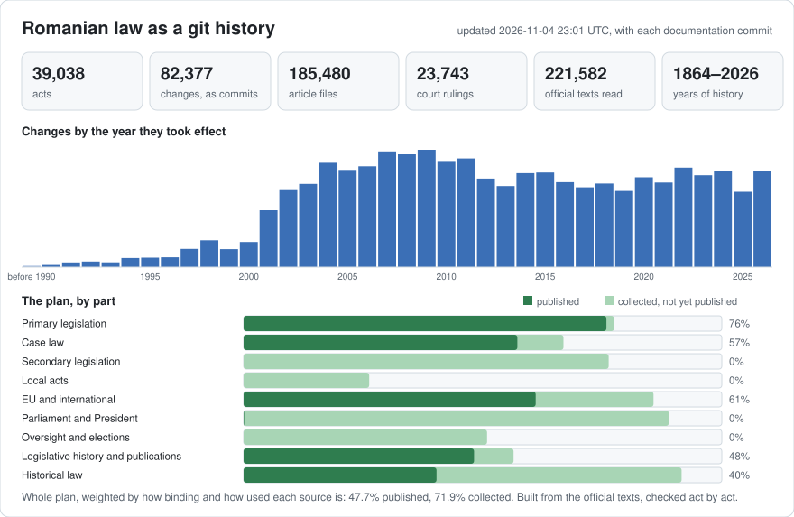

# Romania: law history in git

Part of [lexifina/global-law](https://github.com/lexifina/global-law), one git history for every country's law: this is Romania's national law, which global-law reads at `romania/national/acts/`.

The aim: every source a Romanian lawyer or citizen needs, in one git history. Laws and their full histories, case law, secondary legislation, local acts and more: the [plan](PLAN.md) lists every part, with its progress.

**Scope**
- Rebuilt Romanian law from the official texts as one git history: the Constitution, the codes and tens of thousands of laws, ordinances and Government decisions.
- Linked Constitutional Court and High Court rulings to the articles they concern, and added the European Court of Human Rights' judgments against Romania and the EU Court of Justice's decisions concerning Romania.
- Added the EU regulations and directives in force, in their Romanian Official Journal text.

**Use**
- The official portal shows one version of an act at a time, so tracing how a provision changed, or what it said on a given date, means comparing versions by hand. Here it is one `git log` or `git blame`.
- The whole history can be searched, compared and reused: the texts are official, and our work on them is in the public domain (CC0).

<picture>
<source media="(prefers-color-scheme: dark)" srcset="data/effort-dark.svg">

</picture>

### See it in use: the Romania MCP

https://github.com/user-attachments/assets/3f47ad88-f514-4765-97e3-ff67ed8f79b4

An AI assistant answering a question about Romanian law through the MCP: the answer cites the exact article and version in this repository, with the official links.

### Romanian law, drawn

Thirty charts drawn from this repository: who makes Romanian law, how the codes and the Fiscal Code change, the Constitutional Court, the Official Gazette, and Romania against its neighbours and the rest of global law. See [visualisations/](visualisations/) for every chart and the interactive pages.

## Layout

| Where | What |
| --- | --- |
| `constitutie/1991/` | the Constitution |
| `lege/<year>/<number>/` | laws, including the codes adopted by law (Codul civil is `lege/2009/287/`) |
| `oug/<year>/<number>/` | Government emergency ordinances (Codul administrativ is `oug/2019/57/`) |
| `og/<year>/<number>/` · `hg/<year>/<number>/` | Government ordinances · Government decisions |
| `<act>/art-NNN.md` | one article per file, one paragraph, letter or point per line; art. 112^1 is `art-112-1.md` |
| `<act>/README.md` | the act's articles, versions and any decisions made by hand for it |
| `ue/<kind>/<year>/<number>/` | EU regulations and directives in force, in their Romanian Official Journal text (`ue/regulament/2016/679/` is the GDPR) |
| `anexa/<act id>/<annex>/` | official annexes held apart from their act: court circumscriptions, small-claims and legal-aid forms |
| `tratat/<year>/<MM-DD>-<type>/` | treaties and international agreements, as published in the Monitorul Oficial with the act that ratifies or approves them, named by their signing day and type (`tratat/2024/05-21-acord/`); `data/treaty-links.csv` links each to its ratifying act |
| `profesii/<body>/...` | the legal professions' own rules (statutes, codes of ethics, regulations, decisions): UNBR, INPPA, OCJR, UNEJ, Consiliul de Mediere, CAFR; CSM, INM and UNPIR as metadata |
| `jurisprudenta/` | court decisions: `ccr/`, `iccj/<panel>/`, `cedo/`, `cjue/` (Court of Justice of the EU) |
| [ACTS.md](ACTS.md) | the primary legislation (Constitution, laws, ordinances, decrees, codes), with folder, status and span; every other kind is listed by year in `data/acts/<kind>/<year>.md` (local acts: `data/acts/local/<council>/<year>.md`) |
| `data/` | `acts.json`, `versions.json` and `laws.csv` for the primary legislation, the same files for every other kind under `data/acts/`, `data/versions/` and `data/laws/` (one per kind and year, all listed in `data/index.json`), `paths.json` and the CSV tables below |
| `tools/` | `on.py` and `in_vigoare_la.py` (the law on any date), `freshness.py` (how current an act is); `tools/build/` holds the builder |
| [AGENTS.md](AGENTS.md) | how a program or an AI agent should query this repository |

Each act also has a short id (`codul-civil`, `legea-31-1990`) used by the tools and tags. Folders were named by id until November 2026; `git log` on one file needs `--follow` across that move.

## Use it

| Question | Command |
| --- | --- |
| What did art. 1112 of the Codul civil say on 18 October 2014? | `python tools/on.py 2014-10-18 lege/2009/287 1112` |
| The whole act on a date | `python tools/on.py 2000-01-01 constitutie/1991` |
| Which act wrote each paragraph of art. 336 of the Codul penal? | `git blame lege/2009/286/art-336.md` |
| Every change to an article, word by word | `git log --follow -p --word-diff lege/2009/286/art-297.md` |
| Everything one act changed | `git show law/legea-200-2023` |
| An act as it stood from a day | `git show codul-penal/2023-07-09` (tags `<id>/<in-force day>`) |
| Is the Codul civil here current? | `python tools/freshness.py codul-civil` |

Read dates with the tools, not `git rev-list --before`: they pick each version by its `In-force:` trailer.

## Data tables

| File | What |
| --- | --- |
| `data/index.json` | every act list: the primary files (`acts.json`, `versions.json`, `laws.csv`) and one shard per other kind and year, e.g. `data/acts/hg/2016.json`, `data/versions/ordin/2012.json`, `data/laws/local/bucuresti/cgmb/2016.csv`; `data/sources/<kind>/<year>.csv` lists the sources of those acts (REPRODUCE.md lists the rest) |
| `data/freshness.json`, `data/freshness/` | when each act was last checked against its official source, and its status (see [How current is it](#how-current-is-it)); `data/freshness/index.json` lists the files |
| `data/status.json` | whether updates are running, the last publication, the last 24 hours, and each official source's availability, refreshed hourly (see [Is it being updated?](#is-it-being-updated)) |
| `data/act-links-<year>.csv` | links between acts (amends, repeals, approves, promulgates, republishes…) from the Chamber of Deputies' database, one file per year of the act that acts (`act-links-before-1990.csv`, `act-links-other.csv` for acts with no year); sheets captured 2018–2025, read again on cdep.ro and from archived copies from November 2026; `evidence` says where each link is stated: the Chamber's sheets (`source sheet`, `target sheet`, `note`, `mof`), the act's own official title (`title`: "pentru modificarea Legii nr. …"; `approves` there covers approval with or without changes) the bill file of the law (`bill file`) or the official record of the promulgation decree (`promulgation record`, as in `data/promulgation.csv`); not official, and a missing link does not mean no change |
| `data/bills-<year>.csv` | one file per year of the bill's registration: the bill behind each law since 1996 and the bills still in Parliament: Chamber and Senate numbers, initiator, first and decisional chamber, adoption dates, the Chamber's vote, Constitutional Court referral, re-examination, promulgation decree, and links to the Legislative Council's opinion, the explanatory memorandum and the adopted text, from the Chamber of Deputies' bill files; not official |
| `data/bill-initiators-<year>.csv` | one file per year of the bill's registration: the members of Parliament who initiated each bill (as Parliament's bill files name them, with their chamber and group); a citizens' initiative's committee is not listed |
| `data/bill-documents.csv` | the documents linked from each bill file: the Legislative Council's opinion, the Economic and Social Council's opinion, the Government's point of view, the explanatory memorandum and the text sent for promulgation |
| `data/eu-transposition.csv` | the EU acts each Romanian act transposes, from Romania's notifications to the Commission (`nim`), the act's own note (`clause`) or both; `eu_folder` is the EU act's folder under `ue/`, once it is here |
| `data/decisions.csv`, `data/rulings-by-provision.json` | every court decision here, and the decisions on each article |
| `data/echr-romania.csv` | European Court of Human Rights judgments and decisions against Romania transmitted for execution: application, case title, date, final date, outcome, articles violated, HUDOC and HUDOC-EXEC links, state of execution, and the folder in `jurisprudenta/cedo/` |
| `data/promulgation.csv` | the decree that promulgated each law |
| `data/treaty-links.csv` | treaties and the acts that ratify them |
| `data/rectifications.csv` | rectifications in the Monitorul Oficial and the acts they correct |
| `data/mo-issues.csv` | an index of Monitorul Oficial issues |
| `data/local-taxes.csv` | local councils' decisions on local taxes, by locality and year |

Practical tables, each row citing the provision it comes from (information, not legal advice):

| File | What |
| --- | --- |
| `data/court-jurisdiction.csv`, `data/court-localities.csv` | the judecătorie, tribunal, court of appeal and prosecutor's offices for every municipiu, oraș, comună, Bucharest sector and village (SIRUTA code); HG nr. 1.217/2023, Legea nr. 304/2022 |
| `data/courts.csv` | every court: seat, county, parent courts |
| `data/court-fees.csv` | taxa judiciară de timbru, one row per provision (OUG nr. 80/2013) |
| `data/monetary-thresholds.csv` | competence limit, small-claims ceiling, bail brackets, fines, legal-interest formulas |
| `data/minimum-wage.csv`, `data/legal-interest.csv` | the minimum gross wage since 1991; legal interest by period since 2011 (BNR rate, OG nr. 13/2011) |
| `data/procedural-deadlines.csv` | appeal, recurs, prescription, administrative, contravention, labour and criminal deadlines |
| `data/legal-aid-rules.csv`, `data/legal-aid-services.csv` | who qualifies for ajutor public judiciar (OUG nr. 51/2008) and the bar service beside each judecătorie |
| `data/forms-index.csv` | official forms (small claims, EU procedures, tax forms) and the acts approving them |

## Case law

All 23,743 decisions are here, as published in the Monitorul Oficial, Part I: 21,561 of the Constitutional Court (from 1992), 1,863 binding decisions of the High Court of Cassation and Justice (RIL and HP, from 1998) and 319 European Court of Human Rights judgments against Romania. Each folder holds the text and `meta.json`. Each decision is one commit of kind `ruling`, tagged `ruling/<id>`; a ruling changes no act file, and a Constitutional Court decision that changed a text is a separate commit of kind `court` in that act's history. Parties' names are as the Monitorul Oficial prints them. The portal holds about 85% of the Constitutional Court's yearly totals in recent years.

`jurisprudenta/cjue/` holds 568 decisions of the Court of Justice of the EU and the General Court concerning Romania (preliminary references from Romanian courts, actions by or against Romania; 574 found in CELLAR): the operative part (`dispozitiv.md`) and `meta.json`, with the referring court and the EU acts interpreted. Full texts name the parties' lawyers, so they are linked, not copied.

ECHR judgments against Romania that the Monitorul Oficial never published in Romanian are in `jurisprudenta/cedo/` as `meta.json` only (`"text": null`): application number, case title as the Court gives it, date, outcome, articles found violated, ECLI and the HUDOC link, from the Council of Europe's HUDOC-EXEC records. Their commits are dated on the day of the judgment. Judgments that found no violation are not in those records, so they are not here yet.

## Dates, authors and limits

- Each commit is dated on the day the change took effect, by each act's own clause or the default rule (Constituția art. 78: three days after publication). The author is the act that made the change; the committer is Lexifina.
- A change is credited to an act only when the portal's amendment note names it; changes no note explains are labelled "unexplained". Judgement calls are recorded in each act's `README.md` and listed in `REPRODUCE.md`.
- Each act's latest version is the newest consolidated form held, so later amendments may be missing. Acts marked `amended, not consolidated` hold only the act as published; their `README.md` names the amending acts.
- Only the Monitorul Oficial, Part I is authoritative (for EU acts, the Official Journal of the EU); no consolidated text, ours included, has legal force.
- Not included: chapter and section headings, the portal's editorial notes, and annexes or figures printed as facsimiles or in a separate issue.

## How current is it

Every version names the official page it was read from, so every act can be checked against its source. `data/freshness/` records, for each act, the last day a check of the official source confirmed that the version here is still the newest, how it was checked, and any change the source reports that is not here yet.

<!-- freshness-summary -->
Checked against the official sources: 2026-11-06; 73% of acts verified in the last 7 days, 73% in the last 30 ([data/freshness.json](data/freshness.json)).
<!-- /freshness-summary -->

    python tools/freshness.py codul-civil          # one act: status, last check, newest change, official link
    python tools/freshness.py --stale --kind hg    # acts not checked within their threshold
    python tools/freshness.py --summary            # the counts, by kind and source

| Status | Meaning |
| --- | --- |
| `current` | checked within its threshold, and no known change is missing |
| `pending-change` | the official source reports a change not here yet: an amendment, a repeal, a newer EU consolidated version or an end of validity |
| `stale` | last checked longer ago than its threshold |
| `unverified` | never checked for later changes, as with most orders ("as published, amendments not yet checked") |
| `source-unavailable` | due for a check, but the official source is not answering |

The threshold is 7 days for the Constitution, codes, laws, ordinances, decrees and Government decisions, and 30 days for orders and other secondary legislation, local council decisions, EU acts and the acts of authorities and professional bodies. A repealed act does not change again, so it has none; court decisions do not change once published and have no rows. The tool works offline from these files: to be certain, open the official link it prints.

### Is it being updated?

The pipeline that keeps this repository current is monitored around the clock: each official source's availability, the publishing itself, every collection lane, the freshness above, and the repository's own size and integrity. Problems raise alerts for the maintainers. Its public part, [data/status.json](data/status.json), is refreshed every hour:

| Field | Meaning |
| --- | --- |
| `updates` | `running` while new versions are being published |
| `last_published` | when the newest commit reached this repository |
| `published_last_24h` | commits and new acts published in the last 24 hours |
| `official_sources` | each official source's state (`available`, `unavailable`), since when, and the last successful contact |

Source states are as seen from the pipeline: a source marked unavailable did not answer it, and may still be up for you. While an official source is unavailable, its acts show `source-unavailable` or `stale` above rather than an out-of-date `current`.

## How it is built and checked

Every version names the page it was read from and that page's sha256. Every version of every act is read back from git on the day it took effect and the day before (`tools/build/check_repo.py`) and must match the corpus; `main` has no merge commits, dates never go backwards, and a rebuild gives identical hashes. Results are in `REPRODUCE.md`.

## Sources

| Source | Used for |
| --- | --- |
| [Portalul legislativ](https://legislatie.just.ro), Ministerul Justiției | the official texts, every consolidated form and the amendment notes |
| – | archived copies of the portal's pages, each capture pinned per version |
| [legalize-ro](https://github.com/legalize-dev/legalize-ro) | a check of the Codul fiscal's text |
| [Camera Deputaților](https://www.cdep.ro), legislation database and bill files | `data/act-links-<year>.csv`, `data/bills-<year>.csv`, `data/bill-initiators-<year>.csv`, `data/bill-documents.csv` |
| [EU Publications Office](https://op.europa.eu) (CELLAR) | the Romanian texts in `ue/` and the decisions in `jurisprudenta/cjue/` (© European Union, https://eur-lex.europa.eu; Commission Decision 2011/833/EU, CC BY 4.0); `data/eu-transposition.csv` (CC0) |
| The professional bodies' own sites (unbr.ro, inppa.ro, ocjr.ro, executori.ro, consiliuldemediere.ro, cafr.ro) | the texts in `profesii/` (official texts, Legea nr. 8/1996, art. 9 lit. b) |
| [INS SIRUTA](https://data.gov.ro) and the [BNR](https://www.bnr.ro) rate table | locality codes in the court tables; `data/legal-interest.csv` |
| [HUDOC-EXEC](https://hudoc.exec.coe.int), Council of Europe | `data/echr-romania.csv` and the metadata-only ECHR entries in `jurisprudenta/cedo/` |

## Licence

The legal texts are official texts of Romanian normative acts (Sursa: Portalul legislativ al Ministerului Justiției, https://legislatie.just.ro), excluded from copyright by Legea nr. 8/1996, art. 9 lit. b. The EU texts in `ue/` and `jurisprudenta/cjue/` are © European Union, reused under Commission Decision 2011/833/EU. Lexifina's arrangement, tables, commit messages and tools are in the public domain (CC0), as set out in `LICENSE`. This repository is not legal advice and not an official publication.

## În limba română

Istoria dreptului românesc în git: un fișier pentru fiecare articol și un commit pentru fiecare modificare, datat în ziua intrării ei în vigoare și semnat de actul care a făcut-o. Lista actelor este în [ACTS.md](ACTS.md); textul în vigoare la o dată: `python tools/on.py 2014-10-18 lege/2009/287 1112`. Sursa: Portalul legislativ al Ministerului Justiției (legislatie.just.ro). Niciun model de inteligență artificială nu a scris text juridic.
