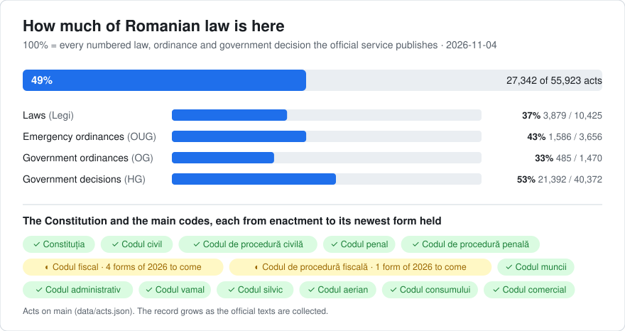

# Romania: law history in git

<picture>
<source media="(prefers-color-scheme: dark)" srcset="data/coverage-dark.svg">

</picture>

The law of Romania as a git history: one file per article, one commit per change on the day it took effect, and the act that made each change as the commit's author. `git blame` names the act behind every paragraph, `git log` lists every change to an article, and the tools give the text in force on any date. The texts are in Romanian, as published.

It follows the shared design of [lexifina/global-law](https://github.com/lexifina/global-law), which places it at `romania/national/acts/`.

## Scope

This repository holds Romania's **primary legislation**: the Constitution, the laws of Parliament (the codes among them), and the Government's emergency ordinances (OUG), ordinances (OG) and decisions (HG). The card above counts them against every such act we have found in the official service; that list is still growing, so the real total is higher.

**Not here yet.** The official portal publishes about 306,000 documents. Besides the acts above, they include:

| Kind of document | On the portal (about) |
| --- | ---: |
| Orders of ministries and authorities (ordine) | 67,000 |
| Presidential decrees (appointments, decorations, promulgations, pardons) | 37,000 |
| Decisions of the Constitutional Court | 24,600 |
| Regulations, norms, methodologies and procedures of authorities (BNR, ASF, ANRE, ministries) | 24,000 |
| Decisions of the Prime Minister and individual Government decisions | 9,700 |
| Decisions of the Chamber of Deputies and the Senate | 7,000 |
| Treaties, agreements, conventions and protocols | 4,700 |
| Decisions of the High Court of Cassation and Justice published in the Monitorul Oficial | 1,900 |

Ordinary court judgments, local council decisions and EU law are almost absent from the portal (a few hundred documents each): they are published elsewhere.

## Layout

| Where | What |
| --- | --- |
| `constitutie/1991/` | the Constitution |
| `lege/<year>/<number>/` | laws, including the codes adopted by law (Codul civil is `lege/2009/287/`) |
| `oug/<year>/<number>/` | Government emergency ordinances (Codul administrativ is `oug/2019/57/`) |
| `og/<year>/<number>/` · `hg/<year>/<number>/` | Government ordinances · Government decisions |
| `<act>/art-NNN.md` | one article per file, one paragraph, letter or point per line; art. 112^1 is `art-112-1.md` |
| `<act>/README.md` | the act's articles, versions and the decisions made by hand for it |
| [ACTS.md](ACTS.md) | every act, with its folder, status and span; the codes first |
| `data/` | `acts.json` (one row per act), `paths.json`, `versions.json` and CSV tables |
| `tools/` | `on.py` and `in_vigoare_la.py` (the law on any date); `tools/build/` holds the builder |
| [AGENTS.md](AGENTS.md) | how a program or an AI agent should query this repository |

Each act also has a short id (`codul-civil`, `legea-31-1990`, `hg-10-2016`) used by the tools and the tags. Until the layout move of November 2026 the folders were named by id; `git blame` and the tools follow the move, and `git log` on one file needs `--follow`.

## Use it

| Question | Command |
| --- | --- |
| What did art. 1112 of the Codul civil say on 18 October 2014? | `python tools/on.py 2014-10-18 lege/2009/287 1112` |
| The whole act on a date | `python tools/on.py 2000-01-01 constitutie/1991` |
| Which act wrote each paragraph of art. 336 of the Codul penal? | `git blame lege/2009/286/art-336.md` |
| Every change to an article, word by word | `git log --follow -p --word-diff lege/2009/286/art-297.md` |
| Everything one act changed | `git show law/legea-200-2023` |
| An act as it stood from a day | `git show codul-penal/2023-07-09` (tags `<id>/<in-force day>`) |

Read a date with the tools rather than `git rev-list --before`: they choose each version by its `In-force:` trailer. After a rebuild, refresh tags with `git fetch --force --tags`.

## Dates and authors

- Each commit is dated at noon, Europe/Bucharest, on the day the change took effect; `Enacted:`, `Published:` and `In-force:` are trailers. The in-force days are the portal's, which apply each act's own clause or the default rule (Constituția art. 78: 3 days after publication in the Monitorul Oficial).
- The author is the act that made the change, with an address that cannot exist (`legea-200-2023@legislatie.invalid`); the committer is Lexifina. A change is credited to an act only when the portal's amendment note names it; Constitutional Court decisions that changed the text are commits of kind `court`. Changes no note explains are committed by the publisher and labelled "unexplained".
- Where an act needed a judgement (a missing form, a republication, an article the source leaves out), the decision is in that act's `README.md`;

## Limits

- Each act's latest version is the newest consolidated form held; amendments in force after it may be missing.
- Not included: chapter and section headings, the portal's editorial notes, annexes and figures printed as facsimiles or in a separate issue, and rulings that interpret a text without changing its wording.

## How it is checked

Every version of every act is read back from git on the day it took effect and on the day before (`tools/build/check_repo.py`), and must match the corpus. `main` has no merge commits, dates never go backwards, every trailer parses, and a second build from the same data gives identical hashes. Results are in `REPRODUCE.md`.

## How it is built

Lexifina reads the sources listed here and records each act's dated versions, and the laws that made each change, in one corpus file. `tools/build.py` writes this repository from that file, and the same corpus always gives the same commit hashes; `REPRODUCE.md` gives the details and the checks. A model (Claude) wrote Lexifina's code; it wrote no legal text, and no model runs when the history is built.

Every version names the page it was read from and that page's sha256.

## Sources

| Source | Used for |
| --- | --- |
| [Portalul legislativ](https://legislatie.just.ro), Ministerul Justiției | the official texts, every consolidated form and the amendment notes |
| – | archived copies of the portal's pages, each capture pinned per version |
| [legalize-ro](https://github.com/legalize-dev/legalize-ro) | a check of the Codul fiscal's text |

## Licence

The legal texts are official texts of Romanian normative acts (Sursa: Portalul legislativ al Ministerului Justiției, https://legislatie.just.ro), which Romanian copyright law excludes from protection (Legea nr. 8/1996, art. 9 lit. b). The arrangement, tables, commit messages and tools are by Lexifina, under the terms in `LICENSE`. This repository is not legal advice and not an official publication.

## În limba română

Istoria dreptului românesc în git: un fișier pentru fiecare articol și un commit pentru fiecare modificare, datat în ziua intrării ei în vigoare și semnat de actul care a făcut-o (`git blame` numește actul fiecărui paragraf). Lista completă a actelor este în [ACTS.md](ACTS.md).

- Textul în vigoare la o dată: `python tools/on.py 2014-10-18 lege/2009/287 1112`
- Datele sunt cele ale Portalului legislativ; regula generală este art. 78 din Constituție.
- O modificare este atribuită unui act numai dacă nota de modificare a portalului îl numește.
- Ultima versiune a fiecărui act este cea mai nouă formă consolidată pe care o avem: modificările ulterioare pot lipsi.
- Sursa: Portalul legislativ al Ministerului Justiției (legislatie.just.ro). Niciun model de inteligență artificială nu a scris text juridic.
